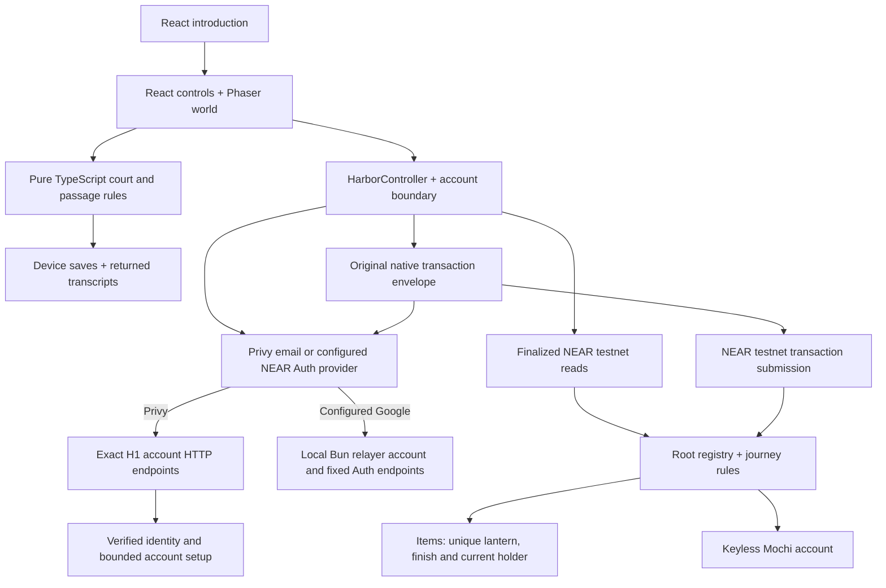

# Familiar architecture

Current source, November 13, 2026. The introduction at `/` leads to the single Phaser game at `/outing/`. Current checks are in [JUDGES.md](../JUDGES.md), deployment status is in [PROGRESS.md](../PROGRESS.md), and dated acceptance is preserved in [archived reports](ARCHIVED-REPORTS.md). Local changes are not automatically published.

## Play and persistence

`web/src/expedition/engine.ts` and `passage.ts` own deterministic rules. Phaser `scene.ts` presents their results, companion poses and input targets; React supplies essential text, buttons and contained panels. Accepted turns persist before their animation. Inspect is free, sound is opt-in, and reduced motion changes presentation rather than outcomes. The document fits the viewport.

`Game.tsx` separates device-preview saves from account-bound saved outings. `ReturnRecords` verifies returned command transcripts and coordinates writes across tabs with Web Locks. Historical transcripts use the frozen validator in `web/src/compatibility/`; their original content IDs and operation IDs retain their meaning. Bell/Reed side discoveries are device/harbor scoped and do not issue H1 tokens, Shells or achievements. Login never silently merges preview memories into canonical progress.

`HarborController` reads current account, companion, checkpoint, accepted claims and item balances before reviewing canonical interactions. It verifies the original return hash before proposing another payment. Current item balance gates placement and mutation; ownership transfer does not transfer the maker's achievement. Craft, commission and finish retain the finite H1 rules: one protected first-light craft credit, one new salvage, one personal 12-Shell commission and one optional 12-Shell finish per token. Bound Shells have no cash redemption.

## Identity and transactions

`account/PrivyProvider.tsx` and `privy-adapter.ts` preserve the authenticated canonical NEAR wallet and named player binding. The separately configured NEAR Auth adapter remains available through `account/client.ts` and `auth-sdk.ts`. Restore/sign-in does not provision another account. An explicit username action provisions only after identity and availability checks.

`tidebound/client.ts` persists canonical transaction bytes before provider navigation. It verifies the provider signature against those bytes, keeps an original envelope through unknown outcomes, and validates full finalized receipt graphs before settlement. Expiry clearing requires proof of permanent expiry plus an unused nonce at a pinned finalized block; it does not cancel a contract reservation or grant a refund. Ordinary movement, conversation, audio and presentation need no transaction.

`services/relayer/src/tidebound-http.ts` is the Node H1 function entry used by the current prepared release. It accepts only `/api/health`, `/api/v1/privy/wallet` and `/api/v1/privy/player` with their configured methods. Private runtime configuration enables it separately. App-scoped identity, exact origin, strict body/size, canonical wallet ownership and bounded account setup remain server checks. It is not a general signing or transaction relay endpoint. The optional local Bun relayer retains older allowlisted protocol support for reproducible testnet tooling.

## Contracts and compatibility

Root owns the registry, authorization and accepted journey state. Items owns lantern mint/finish evidence and balances. Predecessor and current-holder checks remain authoritative; callbacks are private and preserve uncertain reservations. `contracts/common/src/court.rs` supplies spatial replay; `historical_returns.rs` preserves old content semantics. Fixture tests compare TypeScript/Rust transitions.

Bakery, Market and configured pool IDs remain part of the existing Pet/Items initialization and historical contract system. Their sources are also used by actual-Wasm upgrade sandboxes. They are not extra current outing activities. The dynamic NPC quote worker has been retired; Bram's current commission runs in Root. The mock pool is local-test infrastructure only. Root/Items administrative keys still exist on testnet; the whole stack is not immutable, even though adopted Pets use pinned global code and no access keys.

## Build and release

Bun manages the workspace; Vite builds React/Phaser and Rust supplies contracts. Original PNGs and generator-only inputs stay outside `web/public/`; committed optimized WebPs are used at runtime. Provenance and source hashes are retained. The release packager builds fresh introduction/outing pages and current assets, retains exact H1 endpoint aliases, and omits retired pages and generator-only art. It prepares a local artifact and does not publish it.

Full unit tests, Rust tests and browser emulation establish narrower checks than physical-phone listening, two-device earned-state recovery or human enjoyment. Those remain explicit validation gaps. The GitHub workflow checks PR/main changes. The source release builder emits production from explicit Vercel production settings and static-only device previews for other environments. Vercel’s Git integration is the deployment trigger; the existing H1 account endpoints remain in the production artifact.
