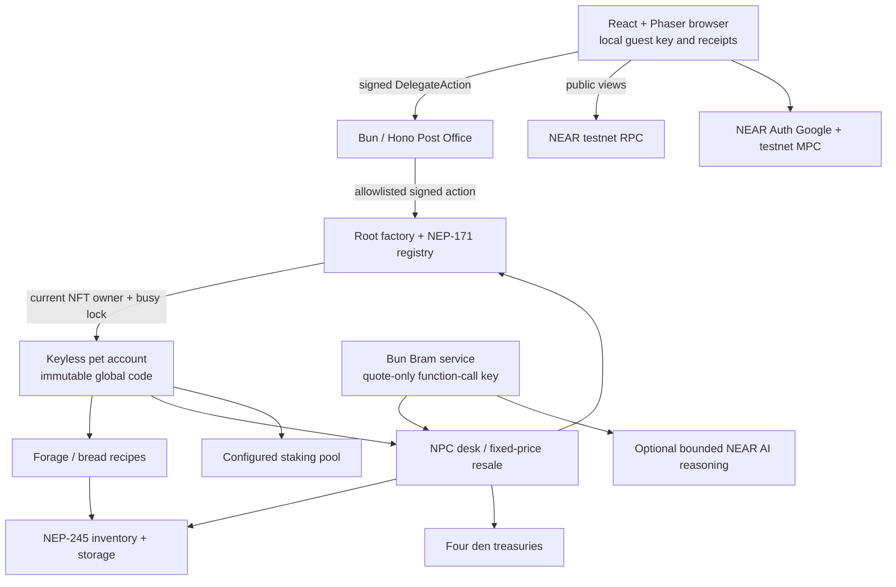

# Familiar architecture

This describes the implementation currently in the repository. Contracts are deployed on testnet and local services have passed real-chain checks; public backend hosting remains a separate evidence gate.

The registry is the sole authority for pet ownership. `act(token_id, action)` checks `predecessor_account_id` against the NFT owner, marks the token busy and returns the pet's promise chain. Pet `execute` accepts only the registry. Transfers, approvals and transfer-call operations serialize against this lock; the standard NFT resolver restores ownership on rejection. There is no cached pet owner that can keep authority after a transfer.

Adoption creates, funds, attaches global code and initializes a pet in a single account-creation batch. No pet access key is added. Only after inventory registration succeeds does the registry mint its token. Pending registration is serialized and bounded; retries retain the storage reservation. Root tracks future guest/NFT storage obligations separately from current protocol storage.

Inventory uses contract-tools' standard multi-token implementation, with seven fixed token IDs. Only registered buildings use the documented non-standard `game_mint`, `game_burn`, `game_transfer` and `game_exchange` extensions. The bakery's burn/mint recipe settles atomically in Items. Failed downstream actions do not charge pet energy or XP. The market authenticates successful item movement through registered inventory accounts, freezes trade terms, reconciles donated stock during quote updates and preserves payout claims on failed transfers.

Market storage capacity comes only from its initialization balance, with an operating floor. NPC deposits and buyer escrow do not expand that capacity. Listings and pending trades/sales reserve bounded space before they can consume downstream state. A sale retains its reservation until actual pet-den lookup and settlement complete.

Den bread and fee scores use fixed four-element arrays and Monday 00:00 UTC periods. Views return zero for an expired period; the first successful event resets only that period's counters. Cumulative bread/fee records, payout claims and treasury funds are retained. The UI checks both view period markers before combining scores across RPC calls.

Staking reserve checks include the pet's actual balance and protocol storage cost. Private callbacks update principal/unstaking state only after success. The UI reads the pool directly for the current dream balance. The mock pool is confined to the sandbox test harness; production pool selection is explicit and verified during deployment.

The relayer decodes canonical Borsh, verifies Ed25519 signatures, checks receiver/method/argument/gas/deposit/expiry policies and the live sender access key, then submits a signed delegate with final execution waiting. Confirmation follows `SuccessReceiptId` from the inner operation's first receipt to its terminal result. Detached payout callbacks cannot turn a completed sale into a false failure. Duplicate requests reserve one in-flight result before asynchronous preflight.

Bram reads inventory, recent prices and held NEAR, computes bounded bigint quotes, then submits `set_quotes` with a scoped key. The optional AI may choose one of three dials and at most 140 characters of reasoning. It never supplies prices or transaction fields. Timeout or absent credentials use the scripted line. Local service ticks every 60 seconds without overlap; an always-running production host has not been connected.

The browser owns signing and persisted guest keys. Phaser owns the town canvas; semantic React controls expose every action. Pending movement is visual anticipation, while inventory and receipts follow confirmed execution. Receipts are centralized in `web/src/receipts.ts`. Read failures pause play and retain the last confirmed state. The wide desktop layout shows the 720px town beside a 480px control column; mobile stacks them with touch-sized controls.

Optional Google retention proves the derived key with an authenticated MPC signature before installing it on the player's account. The original browser key stays valid. Recovery reads the current NFT owner, proves an exact self-AddKey transaction, verifies its MPC signature before broadcast and rechecks both keys and ownership afterwards. A retry recognizes an already-installed local key. The browser backs up its current guest pass before switching the active identity. No pet key or relayer key permission is added. Legacy Auth SDK 5 and signing SDK 7 exchange canonical transaction bytes, never class instances. Shared-client origin checks currently enable localhost:3000 only; actual user OAuth and chain recovery remain unverified.
